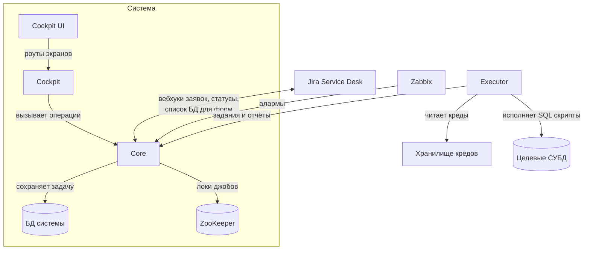
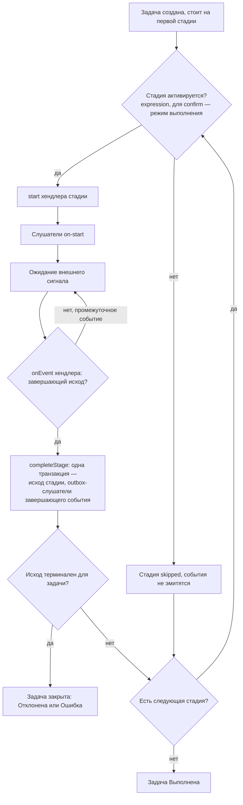
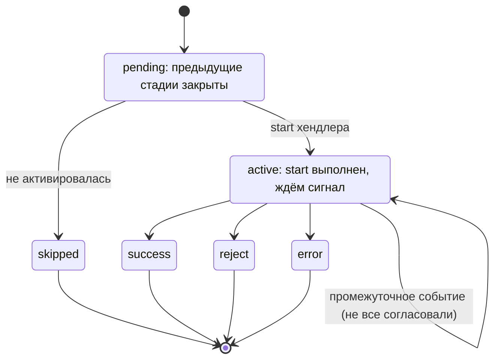
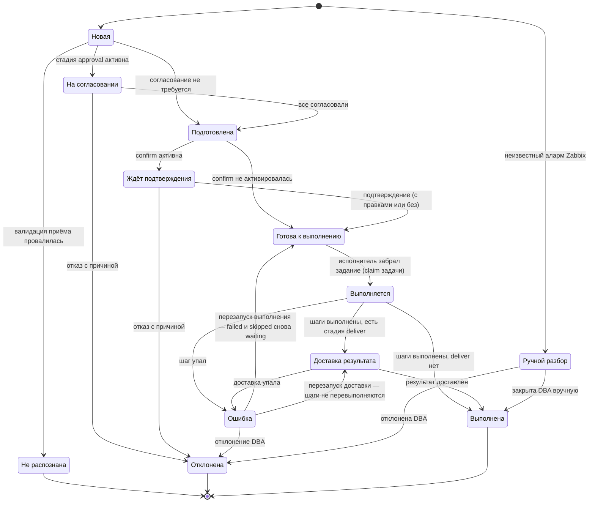
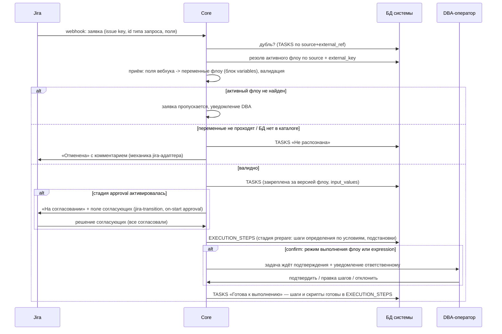
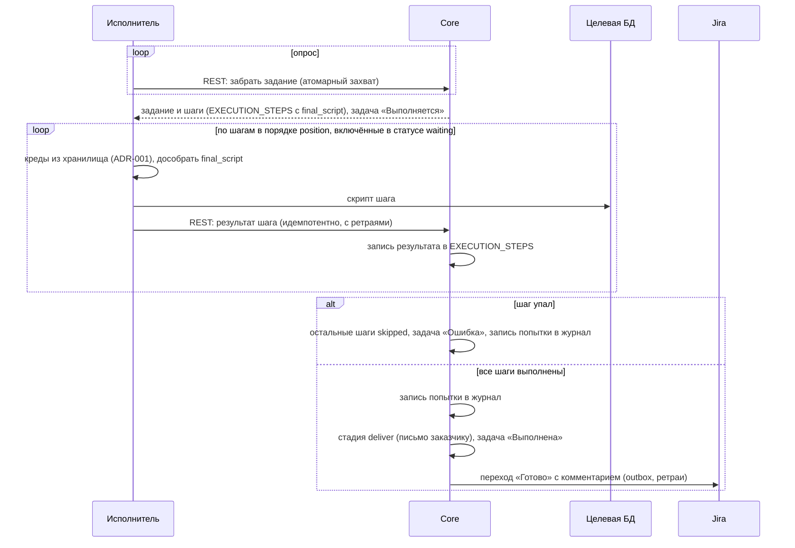

# dba-ops-assistant

Статус: черновик

## Глоссарий

- **Заявка** — тикет в Jira «Центр поддержки», созданный заказчиком.
- **Аларм** — событие триггера Zabbix; канал получения —
  [[adr/006-alarm-channel|ADR-006]] (открыт).
- **Core** (`business-dba-ops-assistant`) — главное приложение системы: принимает
  вебхуки Jira и события Zabbix, валидирует, ведёт задачи по флоу, готовит задания
  исполнителю, шлёт уведомления и обновляет Jira.
- **Движок** — часть Core, интерпретирующая флоу.
- **Cockpit** (`cockpit-dba-ops-assistant`) — бэкенд экранов DBA: вход, сессии,
  роуты; бизнес-логики не содержит, вызывает операции Core.
- **Cockpit UI** (`cockpit-dba-ops-assistant-ui`) — экранное приложение DBA.
- **Executor** (`integration-dba-ops-assistant`) — приложение, выполняющее скрипты
  на целевых БД; вынесено в отдельный репозиторий, потому что рантайм и способ
  поставки у него могут отличаться от серверных приложений.
- **Флоу** — версионируемое описание жизненного цикла задач одного типа операции:
  переменные, стадии, шаги, слушатели.
- **Стадия** — этап флоу.
- **Хендлер** — единица поведения стадии или слушателя.
- **Словарь** — именованный набор записей, на который ссылается флоу.
- **DBA-оператор, DBA-администратор** — DBA-инженеры, роли пользователей Cockpit UI.
- **Заказчик** — автор заявки в Jira.
- **Целевая БД** — база из каталога, на которой выполняется скрипт.
- **БД системы** — собственная база системы: каталоги, конфигурация, задачи, журнал.

## Контекст

Сейчас заявки к DBA идут через Jira «Центр поддержки»: типы заведены, но ключевые поля
(БД, схема, объект, учётка) заполняются свободным текстом, суть часто в «Описании».
DBA разбирает каждую заявку руками: уточняет, подбирает скрипт, выполняет, отписывается.
Алармы Zabbix разбираются так же вручную, на данном этапе это только алармы — заполнение tablespace.

Единого журнала изменений на БД нет: история размазана по тикетам и личным заметкам.
Скрипты операций живут у инженеров, не версионируются и различаются от инженера к инженеру.

## Цели

Цели:

- заявка из Jira становится машиночитаемой задачей без участия DBA;
- каждая операция — согласованная последовательность шагов (проверки и действия) из версионируемых шаблонов скриптов;
- каждое выполнение на БД проходит через один канал и полностью журналируется;
- решение DBA (апрув/правка/отказ) происходит в Cockpit UI;
- типовые алармы Zabbix проходят тот же путь, что и заявки.

Не нужно:

- MySQL, Clickhouse;
- DBA сами добавляют новые шаблоны скриптов, реакций на алармы;
- автоматический перезапуск упавших скриптов;
- автоматический разбор заявок «Прочее» и неизвестных алармов.

## Обзор



Четыре приложения, каждое — свой репозиторий:

| Приложение | Репозиторий | Роль |
|---|---|---|
| Core | `business-dba-ops-assistant` | события, флоу, задания исполнителю, уведомления, Jira |
| Cockpit | `cockpit-dba-ops-assistant` | бэкенд экранов; бизнес-логики не содержит |
| Cockpit UI | `cockpit-dba-ops-assistant-ui` | экраны DBA |
| Executor | `integration-dba-ops-assistant` | выполнение скриптов на целевых БД |

- Core — принимает вебхуки Jira и события Zabbix (канал — [[adr/006-alarm-channel|ADR-006]]),
валидирует заявку по флоу и каталогам, собирает задачу по шагам флоу, сохраняет её в БД системы,
ведёт её по стадиям, шлёт уведомления и обновляет статусы и комментарии в Jira. Только Core пишет
в БД системы. Фоновые процессы Core — джобы под локами в ZooKeeper (см. «Джобы»,
[[adr/008-job-coordination|ADR-008]]).

- Cockpit и Cockpit UI — рабочее место DBA: он видит задачи по закреплённым за ним БД,
подтверждает, правит скрипт, отклоняет. Своих бизнес-правил у них нет: Cockpit вызывает готовые
операции Core, а Cockpit UI — роуты Cockpit. Способ вызова «Cockpit -> Core» (общая библиотека или
внутренний REST) — открытый вопрос, см. «Открытые вопросы».

- Executor — забирает готовые задания у Core (канал — [[adr/002-executor-task-channel|ADR-002]]),
берёт креды целевой БД из хранилища кредов ([[adr/001-creds|ADR-001]]), выполняет SQL и отчитывается
по каждому шагу; результат Core пишет в задачу и журнал. Только Executor имеет доступ к хранилищу
кредов и целевым СУБД. О флоу, стадиях и Jira он не знает — видит только задание: задачу «Готова к
выполнению» и её шаги (`EXECUTION_STEPS`). Вынесен в отдельный репозиторий: рантайм и форма поставки
у него могут отличаться от серверных приложений вплоть до отдельного бинарника.

Executor общается с Core только в направлении «Executor -> Core»:
- забрать задание (атомарно), 
- отчитаться по шагу (идемпотентно, с ретраями).

Основной сценарий:

1. Jira присылает вебхук о новой заявке.
2. Core находит активный флоу по типу заявки, проверяет поля и создаёт задачу,
   закреплённую за версией флоу.
3. Задача проходит стадии флоу: согласование в Jira, сборка скриптов,
   подтверждение DBA в Cockpit UI. Состав стадий и условия их активации задаёт сам
   флоу.
4. Executor забирает готовые скрипты и выполняет их на целевой БД по порядку.
5. Результат каждой попытки попадает в журнал, Core обновляет статус заявки в
   Jira.

Пароли новых учёток отправляются автору почтой, минуя Jira и журнал.

## Конфигурация: флоу, словари, шаблоны

Поведение системы задаёт флоу — по одному на тип операции. Подход:

- флоу пишется yml-файлом в репозитории и проходит ревью как код; миграция
  загружает его в БД и делает активной версией вместо предыдущей, откат —
  возврат активности прежней версии;
- в БД одна запись — одна версия: определение лежит целиком, а поля, по которым
  идёт поиск, загрузчик достаёт из него сам, поэтому разъехаться они не могут;
- входящее событие находит свой флоу по источнику и типу (тип запроса Jira, тип
  аларма Zabbix); активная версия по этой паре всегда одна;
- версии неизменяемы: правка — это новая версия. Задача на всё время жизни
  закреплена за той версией, по которой создана, поэтому правки флоу не задевают
  задачи в полёте, а разница между версиями видна как обычный дифф yml.

Остальная конфигурация: шаблоны скриптов — версионируемый SQL в таблице `SCRIPT_TEMPLATES`
(строка = версия, загрузка миграцией; [[adr/003-template-storage|ADR-003]]); каталоги (БД, закрепления, согласующие
по БД, флаги ручного режима БД) ведёт DBA-администратор в Cockpit UI. Закрытые списки значений форм 
(области, объёмы, привилегии) отдельно не хранятся — это enum-переменные в определении флоу.

### Определение флоу

Заголовки определения:

| Атрибут | Значение |
|---|---|
| `name` | человекочитаемое имя |
| `code` | код операции, нижний регистр: `pg-1`, `zbx-1`; попадает в журнал |
| `version` | версия определения; составной UK с `code`, записи неизменяемы |
| `source` | `jira` \| `zabbix` |
| `external_key` | идентификатор во внешней системе; пара `source` + `external_key` уникальна среди активных версий и служит ключом резолва входящего события |
| `manual_mode` | режим выполнения: `manual` (по умолчанию) \| `auto` \| `by-database`; см. «Режим выполнения» |
| `active` | активная версия; резолв входящих только по активным |

Блок `variables` — конфигурация приёма: как поля источника становятся переменными
задачи.

| Атрибут | Значение |
|---|---|
| `from` | поле источника: `customfield_*` или путь атрибута (`issue.reporter`) для Jira, поле события для Zabbix |
| `type` | `string` \| `number` \| `boolean` \| `enum` \| `dictionary-item` |
| `values` | для `enum`: закрытый список допустимых значений; по нему валидируются приём и литералы выражений |
| `dictionary` | для `dictionary-item`: словарь, по которому валидируется значение; используется только для `databases` |
| `multiple` | значение — список |
| `required` | обязательность; нет значения — заявка не распознана |

Ровно одна переменная флоу — `dictionary-item` по словарю `databases`; она задаёт
целевую БД задачи (`TASKS.database_id`), маршрутизацию и закрепления. Маппинг и
валидацию переменных выполняет механика приёма, до стадий флоу; повторные вебхуки
(решение согласования, изменение заявки) обрабатываются той же механикой
(см. «Движок флоу»).

Блок `stages` — упорядоченный список стадий:

| Атрибут | Значение |
|---|---|
| `code`, `name` | идентификатор в пределах флоу и подпись |
| `handler` | стадийный хендлер; определяет схему `parameters` и набор событий |
| `expression` | JEXL над контекстом задачи; для confirm дополняет режим выполнения |
| `parameters` | параметры хендлера, JSON |
| `listeners` | `on-<событие>` -> список вызовов слушателей, JSON |

Согласование управляется `expression` стадии: в ORA-2 стадия `approval` включается
только для опасных областей прав (`scope == 'any' or public_synonyms`).

#### Режим выполнения

Ручной режим — активация стадии `confirm` (хендлер `dashboard-approval`), авто —
её пропуск. Стадия `confirm` присутствует в каждом флоу. Режим задаёт атрибут
`manual_mode` в шапке флоу, и решение флоу приоритетнее каталога БД:

| `manual_mode` флоу | Поведение |
|---|---|
| `manual` (по умолчанию) | confirm активируется всегда, флаг БД не проверяется |
| `auto` | confirm по режиму не активируется даже на БД, помеченной ручной: операция признана безопасной для любой базы |
| `by-database` | решает каталог: confirm активируется, если у целевой БД взведён `DICT_DATABASES.manual_mode` (правится в Cockpit UI без релиза) |

Сверх режима работает `expression` самой стадии `confirm`: истинное выражение
активирует её в любом случае. Так автор флоу добавляет свои условия подтверждения,
например «критичные БД подтверждаем всегда» (`database_code.critical`).

### Шаги операции

Шаги операции перечислены в параметрах стадии подготовки (`task-preparation`) —
это её программа: что собрать для этой задачи. Порядок записей — порядок
выполнения на целевой БД. Атрибуты шага:

| Атрибут | Значение |
|---|---|
| `code` | уникален в пределах флоу; ключ для `steps.<код>.<ключ>` и отчётов исполнителя |
| `name` | подпись на экранах |
| `template` | ссылка на шаблон в форме `код@версия` |
| `expression` | JEXL над контекстом; ложь — шаг не включается в задачу |
| `params` | значения параметров шаблона: литералы и подстановки `${{ }}`, JSON |

Подготовка и подтверждение — пара стадий: `prepare` собирает шаги задачи со всеми
подставленными значениями, `confirm` показывает результат DBA и даёт его
поправить. Поэтому шаги задаются один раз, в самом флоу, а всё, что относится к
конкретной задаче — отключение шага, правка текста, свой шаг, порядок — живёт
только в её `EXECUTION_STEPS` и во флоу не попадает.

### Стадийные хендлеры

| Хендлер | Параметры | События | Что делает start | Кто и чем завершает |
|---|---|---|---|---|
| `jira-approval` | `approvers` (список логинов) | start, success, reject | собирает согласующих: параметр стадии + `DATABASE_APPROVERS` по целевой БД, дедуп; снапшот с решениями — в payload стадии | вебхук решения из Jira: все approved — success, любой rejected — reject |
| `task-preparation` | `steps` (шаги операции), `custom-steps` (`allowed` \| `forbidden`) | success, error | собирает `EXECUTION_STEPS` из своих шагов: условия, подстановки, `final_script` | движок, синхронно |
| `dashboard-approval` | `approvers` (словарь + фильтр) | start, success, reject | назначает задачу DBA по закреплениям | клик DBA в Cockpit UI: подтверждает любой ответственный |
| `database-execution` | — | start, success, error | переводит задачу в «Готова к выполнению» — исполнитель заберёт её по REST; целевая БД — атрибут задачи | REST-отчёты исполнителя: все шаги done / шаг упал |
| `email-delivery` | `to`, `template`, `data` | success, error | кладёт письмо в outbox | доставка outbox |

События стадии делятся на промежуточные (start; решения части согласующих —
стадия продолжается) и завершающие (success, reject, error — стадия закрывается,
движок продвигает задачу).
Одна стадия — одно действие одного хендлера; составных стадий с частичным отказом нет.

Согласующие стадии approval — ответственные в Jira. Заявка приходит без согласующих — их устанавливает система: 
список задаёт параметр `approvers` стадии (привязан к типу заявки, основной случай) и дополняет каталог
`DATABASE_APPROVERS` по целевой БД; хендлер дедуплицирует логины, фиксирует снапшот
с решениями в `TASK_STAGES.payload` и заполняет этим же списком поле согласующих в
заявке (`${{ stage.approvers }}`). Кворум всегда «все»: любой rejected завершает
стадию исходом reject, все approved — success. Пустой
итоговый список при активировавшейся стадии — задача «Ошибка» (автоапрув исключён); 
по конфигурации такого быть не должно: если согласующих нет, стадию approval во флоу не объявляют.

### Слушатели

| Хендлер | Гарантия доставки | Назначение |
|---|---|---|
| `jira-transition` | outbox с ретраями | переход статуса заявки + комментарий по шаблону + заполнение полей |
| `zabbix-close-event` | outbox с ретраями | закрытие события в Zabbix |
| `notify` | best-effort; канал `jira-comment` — outbox | уведомления DBA (сообщение задачи в топике) и заказчику (комментарий в заявку); см. «Уведомления» |

Гарантия доставки — свойство хендлера: потеря `notify` не страшна,
`jira-transition`, `zabbix-close-event` и `email-delivery` обязаны дойти — результат в
журнале первичен, статус в источнике догоняет.

Формат повторов единый для всех слушателей с гарантией: 5 попыток с задержками 1 минута,
15 минут, 1 час, 2 часа, 5 часов. Слушатель либо использует этот формат, либо объявляется
без повторов — своих расписаний у хендлеров нет. Исчерпание попыток останавливает
доставку; запись остаётся в outbox для разбора, отдельной реакции у слушателя нет. Слушатели объявляются только у
стадий; отдельных событий шагов нет — реакция на упавший шаг задаётся слушателем
on-error стадии execute, которому доступен контекст упавшего шага (`stage.failed_step`).

### Словари

Флоу ссылается на словарь по имени; реестр в коде сопоставляет имя сущности и её
репозиторию, новый словарь — новая таблица и регистрация в реестре. Фильтр словаря —
равенство атрибута записи значению контекста: `database == database_code`.

| Словарь | Таблица | Записи | Кто ведёт |
|---|---|---|---|
| `databases` | `DICT_DATABASES` | целевые БД; атрибуты доступны в выражениях (`database_code.critical`) | DBA-администратор, Cockpit UI |
| `db-assignments` | `DBA_ASSIGNMENTS` | закрепление DBA за БД | DBA-администратор, Cockpit UI |

`databases` — единственный словарь значений (источник словарной переменной): `code` —
уникальный бизнес-ключ, он же значение переменной в `input_values` и в выражениях;
`alias` — подпись; остальные колонки — атрибуты, доступные в выражениях через точку.
Служебный словарь (`db-assignments`) используется только в
параметрах стадий и источником переменных быть не может; согласующие Jira задаются
параметром стадии approval и каталогом `DATABASE_APPROVERS`
(см. «Стадийные хендлеры»).

### Шаблоны скриптов

Шаблон — параметризованный исполняемый SQL; версионируется, правки проходят ревью.
Хранение — таблица `SCRIPT_TEMPLATES` в БД системы: строка = версия (как у флоу),
загрузка миграцией ([[adr/003-template-storage|ADR-003]]). Шаги ссылаются на шаблон
парой `код@версия` без FK — шаг фиксирует версию снапшотом.

| Атрибут | Значение |
|---|---|
| `code`, `version` | ссылка `код@версия`; шаг задачи фиксирует версию |
| `dbms_type` | `oracle` \| `postgres` — СУБД целевой БД |
| `params` | `[{name, type, required}]` |
| `output_keys` | какие колонки итогового SELECT попадают в `result` шага |
| `sql_text` | параметризованный SQL или PL/SQL-блок |

### Шаблоны сообщений

Всё, что система отправляет наружу словами — комментарий в заявку, письмо заказчику,
сообщение в чат команды, — лежит в одной сущности `MESSAGE_TEMPLATES`. Ни один текст не
зашит в код: слушатель и стадия ссылаются на шаблон по коду, как шаги ссылаются на
шаблоны скриптов.

| Атрибут | Значение |
|---|---|
| `code` | ссылка из флоу и слушателей (`task-rejected`, `task-done`, `credentials-mail`) |
| `channel` | `jira-comment` \| `email` \| `chat` — куда уходит текст |
| `subject` | тема; заполняется для писем, для остальных каналов пуста |
| `body` | текст с подстановками `${{ }}` — теми же выражениями, что и в шаблонах скриптов |
| `description` | для кого и когда сообщение; подсказка тому, кто правит текст |

Правки текста — как у шаблонов скриптов: новая версия загружается миграцией и проходит
валидацию (все подстановки шаблона объявлены в контексте задачи, ссылка из флоу существует).
Одно место для всех текстов означает: чтобы поменять формулировку в письме или комментарии,
не нужно трогать код и не нужно искать, в каком из приложений она лежит.

#### Контракт скрипта

Признак успеха один для всех шагов: скрипт отработал без ошибки СУБД. Правил
разбора вывода в конфигурации нет — решение принимает сам скрипт:

- проверка, которая не прошла, обязана уронить себя с внятным текстом:
  `RAISE_APPLICATION_ERROR(-20001, 'Учётка EXTERNAL_PROD уже существует')` в
  Oracle, `RAISE EXCEPTION` в PostgreSQL. Текст попадает в `error` шага, виден
  DBA в Cockpit UI и может уйти комментарием заказчику;
- действие (CREATE USER, GRANT, ALTER TABLESPACE) ничего не проверяет: успех —
  это отсутствие ошибки, оборачивать его в обработчик исключений нельзя, иначе
  теряется код и текст ошибки СУБД;
- если шаг отдаёт значения следующим шагам, он завершается SELECT, чьи колонки
  перечислены в `output_keys`; проверки внутри такого скрипта делаются до
  SELECT и роняют его при провале.

Скрипт свободен внутри: одиночный SQL, PL/SQL-блок Oracle или `DO`-блок
PostgreSQL. Ограничение одно: `DO`-блок PostgreSQL не возвращает результат,
поэтому шаг с `output_keys` на PostgreSQL пишется запросом, а не `DO`-блоком.

### Выражения и подстановки

Два механизма, оба валидируются при загрузке флоу:

- JEXL-выражения: `expression` стадий и шагов;
- подстановки `${{ ... }}` в параметрах стадий, слушателей и шагов.

Неймспейсы контекста:

| Ссылка | Что это | Когда доступно |
|---|---|---|
| `target_username` (имя переменной) | переменная флоу | после приёма |
| `database_code.critical` | атрибут записи словарной переменной | после приёма; атрибуты читаются из словаря на момент вычисления |
| `flow.code` | атрибуты флоу | всегда |
| `stage.approvers` | результат start текущей стадии | в слушателях стадии (start эмитится после инициализации стадии хендлером) |
| `stage.failed_step` | упавший шаг: `code`, `name`, `error` | в слушателях on-error стадии execute |
| `steps.<код>.<ключ>` | `result` предыдущего шага (по `output_keys`) | только в runtime исполнителя |
| `generator.<тип>` | генератор значения (`password`) | только в runtime исполнителя |

Enum-переменная в выражении равна своему значению (`scope == 'any'`), словарная —
коду записи каталога, атрибуты записи — через точку (`database_code.critical`). Подстановки уровня задачи движок резолвит при сборке
(в `EXECUTION_STEPS.final_script`), `steps.*` и `generator.*` остаются плейсхолдерами — их
дособирает исполнитель перед запуском шага.

### Валидация конфигурации

Выполняется при загрузке версии флоу в БД и повторно при старте сервиса для всех
активных версий: невалидная версия не активируется, невалидное состояние
конфигурации не даёт сервису подняться. Проверки:

- структура парсится в типизированные записи, имя хендлера — дискриминатор схемы
  параметров; неизвестный или лишний ключ — ошибка;
- пара `source` + `external_key` уникальна среди активных версий;
- ровно одна переменная по словарю `databases` в каждом флоу;
- стадия `confirm` (`dashboard-approval`) присутствует в каждом флоу — иначе режиму
  ручного выполнения не на что сработать;
- ссылки на словари существуют; шаблоны (`код@версия`) и шаблоны уведомлений
  существуют; `required`-параметры шаблонов закрыты параметрами шагов;
- у стадии approval список `approvers` непуст;
- JEXL-выражения парсятся; переменные в выражениях и подстановках объявлены;
  строковый литерал, сравниваемый с enum-переменной (`scope == 'any'`), существует
  среди её `values`, со словарной — среди кодов словаря;
- одно поле источника означает одну переменную: одинаковый `from` в разных флоу
  одного `source` обязан давать одинаковое имя и тип переменной;
- `steps.<код>` ссылается только на предшествующие шаги, ключ есть в `output_keys`
  шаблона этого шага;
- каждый терминальный исход jira-флоу (reject любой стадии согласования, success
  последней стадии) содержит `jira-transition` — забыть закрыть заявку нельзя.

## Движок флоу

Движок — генерик-интерпретатор: читает конфигурацию флоу и ведёт задачу по
стадиям; знание о конкретных операциях (PG-1, ZBX-1) живёт только в конфигурации.
Приём события источника (резолв флоу, валидация переменных, создание задачи) —
механика адаптеров до движка (см. «Ключевые сценарии»); движку задача приходит
уже созданной. Цикл интерпретации:



Жизненный цикл одной стадии:



Принципы:

- стадии асинхронные: `start` — действие движка, завершение приносит внешний сигнал;
  исключение — синхронные стадии (`task-preparation`), где start сам возвращает исход;
- стадия `confirm` активируется по режиму выполнения флоу (`manual`; `by-database`
  вместе с флагом целевой БД) или по истинному `expression`; при `auto` — только по
  `expression`; остальные стадии — всегда только по `expression`;
- единственная точка продвижения — `completeStage(task, stage, outcome)`: в одной
  транзакции фиксируется исход, пишутся outbox-записи слушателей завершающего события
  и открывается следующая стадия; best-effort слушатели уходят после коммита;
- все внешние сигналы заходят в один вход движка; хендлер активной стадии решает,
  завершена ли она, движок решает, куда дальше;
- версии флоу неизменяемы: задача закреплена за версией (`TASKS.flow_id`) и
  проходит её стадии, даже если активна уже другая версия; сборка, правки DBA и
  результат выполнения — в `EXECUTION_STEPS`, итог каждой попытки — записью в журнале;
- состояние движка целиком в БД (`TASKS`, `TASK_STAGES`, `EXECUTION_STEPS`, outbox) —
  рестарт Core безопасен: активные стадии продолжают ждать сигналов,
  outbox дошлёт недоставленное; в памяти движок ничего не держит;
- повторный вебхук обрабатывается механикой приёма, вне стадий: изменённые
  значения до подтверждения (confirm) перевалидируют переменные, обновляют `input_values` и
  возвращает задачу на начало флоу (согласование заново — прежние решения в
  payload сбрасываются; поздний вебхук прежнего согласования движок отбрасывает,
  сравнивая время решения со временем старта стадии; автошаги пересобираются,
  кастомные шаги DBA сохраняются); после подтверждения изменения не применяются,
  в заявку уходит комментарий; невалидные изменения не применяются никогда.


## Модель данных

Таблицы сгруппированы префиксами: `DICT_DATABASES` — каталог БД, `DBA_*` — люди и
доступ, `DATABASE_APPROVERS` — согласующие по БД, `FLOWS` и `SCRIPT_TEMPLATES` —
конфигурация (версия = запись), `TASK_*` — ход заявки и исполнение, `JOURNALS` —
журнал. Шаг живёт в двух местах: описан в определении флоу (`FLOWS.definition`) ->
собран, поправлен DBA и выполнен (`EXECUTION_STEPS`); история попыток — в журнале.

```mermaid
erDiagram
    DICT_DATABASES {
        number id PK "identity"
        varchar2 code UK "стабильный ключ записи: credit-prod; значение переменной databases"
        varchar2 host "составной UK: host+port+instance"
        number port
        varchar2 instance "Oracle SID/service name, PG database"
        varchar2 cred_ref "ссылка на секрет целевой БД (источник кредов — ADR-001)"
        varchar2 company
        varchar2 dbms_type "CHECK: oracle | postgres"
        varchar2 environment "CHECK: stage | prod"
        number critical "NUMBER(1): критичная БД — только DBA-администратор; в выражениях — database_code.critical"
        number manual_mode "NUMBER(1): операции на БД через confirm; учитывается при flow.manual_mode = by-database"
        varchar2 alias "опционально, показывается в форме Jira"
    }
    DBA_ACCOUNTS {
        number id PK "identity"
        varchar2 login UK "LDAP-логин"
        varchar2 role "CHECK: operator | administrator"
    }
    DBA_ASSIGNMENTS {
        number dba_account_id PK "составной первичный ключ из двух FK"
        number database_id PK "закрепление назначает DBA-администратор"
    }
    DATABASE_APPROVERS {
        number id PK "identity"
        number database_id FK "согласующие Jira по БД; UK с login"
        varchar2 login "логин согласующего в Jira"
    }
    FLOWS {
        number id PK "identity"
        varchar2 code "код операции: pg-1, zbx-1...; составной UK с version"
        number version "версии неизменяемы: правка = новая версия"
        varchar2 name "индексные колонки заполняет загрузчик из шапки definition"
        varchar2 source "CHECK: jira | zabbix"
        varchar2 external_key "ключ резолва; source+external_key уникальны среди активных"
        varchar2 manual_mode "CHECK: manual | auto | by-database; приоритетнее флага БД"
        number active "NUMBER(1): резолв входящих только по активным версиям"
        clob definition "yml целиком: переменные, стадии, шаги, слушатели"
        timestamp created_at
    }
    SCRIPT_TEMPLATES {
        number id PK "identity"
        varchar2 code "составной UK с version; ссылка шага — код@версия, без FK"
        number version "версии неизменяемы: правка = новая версия"
        varchar2 dbms_type "CHECK: oracle | postgres"
        clob params "JSON: [{name, type, required}]"
        clob output_keys "JSON: колонки итогового SELECT, попадающие в result шага"
        clob sql_text "параметризованный SQL"
        timestamp created_at
    }
    TASKS {
        number id PK "identity"
        varchar2 source "CHECK: jira | zabbix"
        number flow_id FK "версия флоу, за которой закреплена задача; null — ручной разбор"
        number database_id FK "nullable: у нераспознанных и ручного разбора БД может отсутствовать"
        varchar2 external_ref "составной UK с source: ключ тикета / id события; идемпотентность приёма"
        clob input_values "JSON (CHECK IS JSON): переменные флоу; словарные — код записи, multiple — массив"
        varchar2 current_stage "код активной стадии; null вне флоу"
        varchar2 status "CHECK по статусной модели"
        timestamp created_at
    }
    TASK_STAGES {
        number id PK "identity"
        number task_id FK
        varchar2 stage_code "составной UK с task_id; строка создаётся при входе в стадию"
        varchar2 status "CHECK: active | skipped | success | reject | error"
        clob payload "JSON: состояние стадии — согласующие и их решения, причина отказа"
        varchar2 decided_by "логин решившего: согласующий Jira или DBA; null для авто и синхронных"
        timestamp started_at
        timestamp finished_at
    }
    EXECUTION_STEPS {
        number id PK "identity"
        number task_id FK
        number position "составной UK с task_id"
        varchar2 code "составной UK с task_id; ключ шага в отчётах и steps.<код>.<ключ>"
        varchar2 name
        varchar2 template_code "код шаблона; для кастомных шагов DBA — null"
        varchar2 template_version
        clob final_script "скрипт с подставленными значениями; generator и steps.* — плейсхолдеры"
        number enabled "NUMBER(1): DBA может отключить шаг до подтверждения"
        number custom "NUMBER(1): шаг добавлен DBA; переживает пересборку автошагов"
        varchar2 status "CHECK: waiting | done | failed | skipped; перезапуск сбрасывает failed и skipped в waiting"
        clob output "вывод скрипта"
        clob result "JSON: извлечённые по output_keys значения — вход для следующих шагов"
        clob error "текст ошибки"
        timestamp started_at
        timestamp finished_at
    }
    JOURNALS {
        number id PK "identity"
        varchar2 source "CHECK: jira | zabbix"
        varchar2 source_ref "ключ тикета заявки или id события Zabbix"
        varchar2 operation_code "код операции: pg-1, zbx-1..."
        varchar2 db_ref "host:port/instance целевой БД"
        varchar2 requested_by "автор заявки / инициатор аларма"
        varchar2 approved_by "DBA-логин, подтвердивший в Cockpit UI; null для auto"
        varchar2 executed_by "DBA-логин или system"
        varchar2 result "CHECK: success | error | manual"
        clob steps "JSON по шагам: [{position, code, script, status, output, error}]"
        timestamp executed_at "ключ секционирования по месяцам"
    }

    DICT_DATABASES ||--o{ DATABASE_APPROVERS : "согласующие по БД"
    TASKS }o--o| FLOWS : "закреплена за версией"
    TASKS }o--o| DICT_DATABASES : "целевая БД"
    TASKS ||--o{ TASK_STAGES : "ход по стадиям"
    TASKS ||--o{ EXECUTION_STEPS : "сборка + правки DBA + выполнение"
    DBA_ACCOUNTS ||--o{ DBA_ASSIGNMENTS : ""
    DICT_DATABASES ||--o{ DBA_ASSIGNMENTS : ""
```



`JOURNALS` не связан внешними ключами ни с задачами, ни с каталогами: он
денормализован, самодостаточен и переживает их удаление. Все данные скопированы
значениями, ссылок нет; одна запись — одна попытка выполнения.

Назначение и основные выборки:

| Сущность | Назначение | Выборки и особенности |
| --- | --- | --- |
| DICT_DATABASES | реестр обслуживаемых БД; источник каскада «компания -> БД» в форме Jira (отдаётся REST-роутом для jiraRunner); атрибуты доступны выражениям флоу | по компании и СУБД (форма); по ответственному (экраны); critical — маршрутизация DBA-администраторам; manual_mode — confirm для флоу с режимом by-database |
| DBA_ACCOUNTS, DBA_ASSIGNMENTS | учётки инженеров и закрепление БД за ними; словарь `db-assignments` | задачи по закреплённым БД |
| DATABASE_APPROVERS | согласующие Jira по целевой БД; дополняют параметр `approvers` стадии approval | чтение на старте стадии approval; ведёт DBA-администратор |
| FLOWS | версионируемая конфигурация флоу: индексные колонки + definition (yml целиком); одна запись — одна версия, загружается миграцией | активный флоу по source+external_key (приём); по flow_id (интерпретация задачи); версии неизменяемы |
| SCRIPT_TEMPLATES | версионируемые шаблоны скриптов: параметры, output_keys, SQL | по код@версия при сборке шагов (prepare); версии неизменяемы, загрузка миграцией |
| TASKS | единица работы; создаётся из заявки или аларма, закреплена за версией флоу | по статусу+ответственному (экраны); по source+external_ref (идемпотентность); claim исполнителем: статус «Готова к выполнению», FOR UPDATE SKIP LOCKED; чистится: терминальные статусы старше недели (см. «Джобы») |
| TASK_STAGES | ход задачи по стадиям: состояние, согласующие и их решения (payload), время | по задаче; активная стадия — адресат внешних сигналов; чистится вместе с задачей |
| EXECUTION_STEPS | собранные шаги задачи: снапшот сборки, правки DBA, статус и результат выполнения | по задаче в порядке position; выполнение строго по порядку, упавший шаг останавливает задание; result — вход следующих шагов; перезапуск сбрасывает failed и skipped в waiting; чистится вместе с задачей |
| JOURNALS | машиночитаемая история выполнений для экранов, аудит и разбор проблем | только добавление, не редактируется и не чистится; денормализован, переживает удаление задач; запись на попытку, скрипты и результат — json по шагам |

### Связь шагов и параметры

Параметры шагов задаются в стадии подготовки подстановками `${{ }}`
(см. «Выражения и подстановки»). Момент подстановки зависит от неймспейса:

| Источник значения | Пример | Кто и когда подставляет |
|---|---|---|
| переменная флоу | `${{ target_username }}` | движок, при сборке (prepare) — в `EXECUTION_STEPS.final_script` |
| атрибут словарной записи | `${{ database_code.environment }}` | движок, при сборке |
| генератор | `${{ generator.password }}` | исполнитель, перед запуском шага |
| выход предыдущего шага | `${{ steps.check-datafiles.asm_disk }}` | исполнитель, перед запуском шага |

Передача между шагами: исполнитель кладёт колонки итогового SELECT в `EXECUTION_STEPS.result`
по `output_keys` своего шаблона; следующий шаг ссылается на значения через
`steps.<код>.<ключ>`. Пример — ZBX-1: check-шаг `check-datafiles` отдаёт `asm_disk`
и `next_datafile`, а action-шаг `add-datafile` использует их в ALTER TABLESPACE.

Структуры json-полей (в коде — типизированные записи, один в один):

- `params` шаблона: `[{name, type, required}]`;
- `output_keys` шаблона: `[name, ...]`;
- `result` шага: `{key: value}`.

Пароль (PG-1/ORA-1): `generator.password`, вычисляется исполнителем при выполнении;
в `final_script`, журнал и логи не попадает. Как пароль доезжает до письма заказчику —
[[adr/004-password-delivery|ADR-004]] (открыт, блокирует стадию deliver).

Отчёт исполнителя: по каждому шагу задания исполнитель записывает статус, вывод
скрипта, извлечённый `result`, текст ошибки и время. Упал шаг — оставшиеся шаги
помечаются «пропущен» (skipped), задача — «Ошибка»; в Cockpit UI
видно, какие шаги прошли, какой упал и почему.

### Статусная модель

Статус задачи — проекция её позиции во флоу; хранится в `TASKS.status` (индексные
выборки экранов), меняет его только движок. Очередь исполнителя — задачи в статусе
«Готова к выполнению»; claim переводит задачу в «Выполняется».



Не показано на диаграмме, чтобы не загромождать:

- «Подготовлена» фиксирует успешную сборку шагов (стадия prepare); вход в
  следующую стадию происходит сразу же, поэтому статус обычно мгновенный — но
  остаётся на задаче, если вход в следующую стадию упал, и виден в истории;
- «Ошибка» достижима из любого нетерминального статуса — это error любой стадии
  (сборка после согласования, выполнение, доставка); статус не терминален, задачу
  разбирает DBA в Cockpit UI. Перезапуск возвращает задачу на упавшую стадию:
  ошибка выполнения — снова «Готова к выполнению», в waiting сбрасываются только
  failed и skipped шаги (done не перевыполняются), перед перезапуском DBA может
  поправить `EXECUTION_STEPS`; ошибка доставки — повтор deliver, шаги не трогаются;
- изменение данных заявки до подтверждения (из «На согласовании», «Ждёт
  подтверждения») возвращает задачу в «Новая» — флоу проходит заново;
- «Ручной разбор» — задача без флоу (неизвестный аларм); DBA закрывает её вручную,
  выполнение фиксируется в журнале с result = manual.

Терминальные статусы: «Не распознана», «Отклонена», «Выполнена».

Workflow типов заявок в Jira даёт всего три перехода:

- «На согласовании» — при входе задачи в согласование; тем же обновлением заполняется
  поле согласующих, которых вычислила стадия approval (`${{ stage.approvers }}`);
- «Готово» — все стадии задачи завершены (on-success последней стадии: deliver у PG-1,
  execute у ORA-2);
- «Отменена» — заявка не распознана при валидации или отклонена; переход один,
  комментарии разные (`task-invalid` / `task-rejected`).

Переходы объявляются в слушателях стадий, где событие происходит; случай «поля
заявки не распознаны» — механика jira-адаптера: флоу-стадий ещё нет, «Отменена» с
комментарием адаптер ставит сам (флоу не найден — заявка пропускается без смены
статуса, см. «Создание задачи»). Повторный вход в согласование (после сброса при
изменении данных) повторит переход «На согласовании» — адаптер обязан считать
переход в текущий статус no-op, иначе outbox-ретраи зациклятся.

## Роли и доступ

В Cockpit UI две роли:

| Роль | Права |
| --- | --- |
| DBA-оператор | задачи по закреплённым за ним БД: подтверждение выполнения, правка шагов, отклонение |
| DBA-администратор | всё, что DBA-оператор, по любым БД + задачи, требующие DBA-администратора; назначает ответственных DBA-операторов за БД; ведёт каталоги (БД, согласующие, закрепления, флаги ручного режима БД) |

Когда требуется DBA-администратор: любая операция на БД с флагом critical в
каталоге.

Маршрутизация: задача попадает в Cockpit UI только тем, кто вправе её выполнить на этой
БД — обычная задача — ответственному DBA-оператору, задача уровня DBA-администратора —
всем DBA-администраторам. Уведомления — в разделе «Уведомления».

Правка шагов разрешена ровно в двух статусах: «Ждёт подтверждения» и «Ошибка»
(перед перезапуском). DBA может отключить шаг (`enabled`), изменить текст
скрипта, поменять шаги местами и добавить свой шаг (`custom`) — собственный
скрипт вне шаблонов. Правки действуют только на эту задачу (в `EXECUTION_STEPS`),
флоу и шаблоны не меняются. В остальных статусах шаги заморожены: подтверждение
фиксирует снапшот, вебхуки его не меняют.

Если данные заявки изменились до подтверждения, задача возвращается на начало
флоу и шаги пересобираются: шаги из флоу создаются заново по новым значениям
(правки DBA в них не переносятся — они относились к прежним данным), шаги DBA
сохраняются и встают в конец списка. DBA получает уведомление и на подтверждении
проверяет порядок и содержимое заново.

Аутентификация в Cockpit — через global-id: вход по учётной записи LDAP.
Роль (оператор/администратор) назначается в системе. Для этого проект должен быть
заведён и сконфигурирован в global-id — отдельная работа при развертывании.

## Уведомления

Два независимых вида: DBA о ходе задач и заказчику о результате.

### Уведомления DBA

Все уведомления идут в один топик группового чата команды DBA. Персональных
каналов и настроек на учётку нет: у команды одно общее место, где видно все
задачи.

Одна задача — одно сообщение. Сигнал об отправке даёт сам флоу — слушатели
`notify` в его стадиях: первый вызов публикует сообщение задачи, каждый следующий
редактирует его же, обновляя статус (ушла на согласование, готова к выполнению,
выполняется, выполнена). Лента в топике не растёт, а текущее состояние задачи
видно в одном месте.

Ошибка — исключение: по `notify` из on-error сообщение задачи редактируется как
обычно, но вдобавок отправляется новое сообщение. Иначе падение потерялось бы в
истории, ведь правка старого сообщения чат никак не подсвечивает.

Когда задача ждёт действия DBA (`notify` на старте стадии подтверждения), в сообщении
упоминаются ответственные: DBA, закреплённые за целевой БД, а для задач на
критичных БД — администраторы. Упоминание означает «нужен ваш запуск» и в
остальных статусах не ставится.

Формат сообщения (примерный):

```text
Новая заявка IT-12312: Создание учётной записи PostgreSQL

БД: test-db (192.176.1.1)
Заказчик: "ikulimanov"
Статус: согласование пройдено, готово к выполнению
Согласующие: approverA, approverB
Ответственные: @nur_dbaA @nur_dbaB

Требуется ручной запуск.
Карточка задачи: https://dba.o.kg/tasks/1847
Заявка в Jira: https://jirasd.o.kg/browse/IT-12312
```

В сообщении: заявка и тип операции, целевая БД с адресом, заказчик, текущий
статус, согласующие с их решением, ответственные DBA и ссылки — на карточку
задачи в Cockpit UI и на заявку в Jira. Строка «Требуется ручной запуск» появляется
только когда система ждёт подтверждения.

Чтобы редактировать сообщение, система помнит его идентификатор в чате: отдельная
сущность «сообщение задачи в чате» — задача, топик, идентификатор сообщения. Она
чистится вместе с задачей.

### Уведомления заказчику

Письмо с кредами созданной учётки (стадия deliver, на корпоративную почту; пароль
временный, в Jira, журнал и логи не попадает) и комментарии в заявку из слушателей
стадий (канал `jira-comment`, через outbox).

## Формы заявок в Jira

Существующие типы заявок не трогаем — они продолжают работать в ручном режиме.
Для системы создаются новые типы заявок: сразу со справочниками и масками вместо
свободного текста, с отдельными полями вместо параметров в «Описании». Кастомные
поля создаём один раз и переиспользуем между формами: одно поле Jira всегда означает
одну переменную с одним именем и типом во всех флоу — это проверяет валидатор
конфигурации. Старые типы закрываются по мере перевода операций на новые.
Формы разделены по СУБД. Jira делает только статичные проверки
(обязательность, маски, списки); существование учёток, схем и ролей проверяет
система check-шагами. Каскад «компания -> БД» — динамический: Core обязан
предоставить REST-роут со списком БД из каталога (фильтры по компании и СУБД
формы), поле заполняется через jiraRunner.

Общие поля всех форм:

| Поле | Тип в Jira |
|---|---|
| Компания | переключатель |
| БД | select; наполняется через jiraRunner REST-роутом Core: каталог по компании, фильтр по СУБД формы |
| Описание | текст |

PG-1 «Создание учётной записи PostgreSQL»:

| Поле | Тип в Jira |
|---|---|
| Имя учётной записи | текст, маска: латиница, цифры, `_` |
| Выдать права сразу | флажок, по умолчанию выкл |
| Блок выдачи прав | при флажке — поля PG-2 |

PG-2 «Выдача прав существующей учётке PostgreSQL»:

| Поле | Тип в Jira |
|---|---|
| Учётная запись | текст, существование проверит система |
| Область | select: схема / собственная схема (владелец) / существующая роль |
| Схема | текст, для областей «схема» и «собственная схема» |
| Объём | select: все объекты / конкретные объекты — для области «схема» |
| Объекты | текст, список — при «конкретные объекты» |
| Привилегии | по типу объекта: таблицы и представления — SELECT/INSERT/UPDATE/DELETE; функции — EXECUTE; последовательности — USAGE/SELECT |
| Роль | текст, для области «существующая роль» |
| Права на будущие объекты | флажок, для области «собственная схема» |

PG-3 «Отзыв роли у учётной записи PostgreSQL»:

| Поле | Тип в Jira |
|---|---|
| Учётная запись | текст, существование проверит система |
| Роль | текст, наличие у учётки проверит система |

ORA-1 «Создание учётной записи Oracle»:

| Поле | Тип в Jira |
|---|---|
| Имя учётной записи / схемы | текст, маска, верхний регистр |
| Выдать права сразу | флажок, по умолчанию выкл |
| Блок выдачи прав | при флажке — поля ORA-2 |

ORA-2 «Выдача прав существующей учётке Oracle»:

| Поле | Тип в Jira |
|---|---|
| Учётная запись | текст, существование проверит система |
| Область | select: схема / владелец своей схемы / вся БД (ANY, всегда апрув) |
| Схема | текст, для области «схема» |
| Объём | select: все объекты / конкретные объекты — для области «схема» |
| Объекты | текст, список — при «конкретные объекты» |
| Привилегии | по типу: таблицы и представления — SELECT/INSERT/UPDATE/DELETE; процедуры, функции, пакеты — EXECUTE; последовательности — SELECT |
| Публичные синонимы | флажок, для «владелец своей схемы», через апрув |
| Database links | флажок, для «владелец своей схемы» |

Заявка «Прочее» остаётся для нестандартных случаев и всегда идёт в ручной разбор.

## Ключевые сценарии

### Создание задачи из заявки Jira



Тип операции опознаётся по `external_key`: у каждого типа запроса «Центра поддержки»
стабильный id, он приходит в вебхуке и указан в шапке флоу. Заказчик и форма код
операции не передают — соответствие «тип запроса Jira -> флоу» хранится у нас.

Вебхуки приходят по всем заявкам «Центра поддержки», а флоу покрывают только
переведённые типы. Событие без активного флоу система пропускает: задача не
создаётся, статус заявки не меняется — она обрабатывается по-старому вручную;
DBA получают уведомление о пропуске (notify + лог).

Что создаётся: одна строка `TASKS` (источник, версия флоу, целевая БД, `external_ref`,
значения переменных, статус), строки `TASK_STAGES` по мере прохождения стадий, строки
`EXECUTION_STEPS` на стадии prepare — по одной на каждый шаг определения, чьё `expression`
истинно для переменных задачи.
Конфигурация при этом только читается.

Аларм Zabbix отличается одним: вместо вебхука — событие Zabbix (канал —
[[adr/006-alarm-channel|ADR-006]]), флоу находится по типу аларма
(`external_key`), переменные маппятся из полей события (`from:
event.tablespace`). Дальше путь общий. Канал получения алармов не выбран
(ADR-006: Kafka, REST-вебхук или опрос таблиц БД Zabbix); состав события
неизвестен — ориентируемся на дефолтную модель событий Zabbix. В первой версии единственная типовая реакция —
ZBX-1 «заполнение tablespace» (Oracle); все остальные алармы создают задачу
«Ручной разбор».

Реакция ZBX-1 шагами (пока режим `manual` — DBA подтверждает запуск; когда
реакции начнут доверять, новая версия переводит флоу в `by-database`, и
подтверждения останутся только на БД, помеченных ручными, затем в `auto`):

1. `check-datafiles` (check): список датафайлов tablespace из `dba_data_files` — на
   каком ASM-диске лежат и по какому образцу именуются; отдаёт `asm_disk` и
   `next_datafile`;
2. `check-asm-free` (check): на ASM-диске есть свободное место (`v$asm_diskgroup`,
   порог `min_free_mb`) — если диск заполнен, реакция останавливается: перенос
   датафайла на другой диск делается только вручную и по разрешению ответственного
   за архивацию;
3. `add-datafile` (action): `ALTER TABLESPACE ... ADD DATAFILE
   '${{ steps.check-datafiles.next_datafile }}' SIZE 10M AUTOEXTEND ON ...`;
4. `check-tablespace-free` (check, контроль): датафайл появился, свободное место в
   tablespace выросло (порог `min_free_percent`).

Особый случай вне auto: месячные табличные пространства — датафайлов добавляется
столько, сколько было в предыдущем месяце; DBA добавляет недостающие `add-datafile`
кастомными шагами на confirm.

Данные, необходимые в событии аларма:

- идентификатор БД/инстанса — для маппинга на запись каталога БД;
- имя tablespace;
- тип аларма (это `external_key` флоу);
- текущее заполнение (размер/процент) — для контроля результата;
- время срабатывания и идентификатор события — для идемпотентности приёма.

### Выполнение задачи исполнителем

> Контракт исполнителя (claim, отчёты) — рабочая гипотеза до принятия
> [[adr/002-executor-task-channel|ADR-002]], см. открытый вопрос 4.



Проверка по словарю целевой БД (существует ли схема, свободна ли учётка) — это
check-шаг задачи, его выполняет исполнитель до action-шагов: до апрува система словарь
не видит (доступ к целевым БД есть только у исполнителя — см. «Обзор»).
Упавший check останавливает задание как обычная ошибка шага; слушатель on-error
стадии execute может при этом отписаться заказчику (`notify`, канал
`jira-comment`) — имя и ошибка упавшего шага доступны шаблону через
`stage.failed_step`, — а DBA в Cockpit UI отклоняет заявку или перезапускает после
правки шагов.

Ручной режим выполнения — активированная стадия `confirm` перед execute: DBA видит
собранную задачу со скриптами, может править и добавлять шаги (правки — только в
`EXECUTION_STEPS` этой задачи) и подтверждает запуск; отказ на подтверждении отклоняет
задачу как обычный reject. Выполняет скрипты всегда исполнитель — пути «DBA выполнил
сам вне системы» нет.

Изменение данных заявки: новая задача не создаётся — по вебхуку обновляются данные
существующей; изменённые значения до подтверждения возвращают задачу на начало
флоу (см. «Движок флоу»).

Завершение задачи. Статусы источника (Jira, Zabbix) переводят слушатели
(`jira-transition`, `zabbix-close-event`) в стадиях, где событие происходит, — тот же
механизм, что и уведомления; разница только в гарантии доставки (см. «Слушатели»):
результат в журнале первичен, статус в источнике догоняет. Доставка результата
заказчику (письмо с кредами для PG-1/ORA-1, пароль — [[adr/004-password-delivery|ADR-004]]) —
отдельная стадия `deliver`, последняя во флоу: «Готово» висит на её `on-success` и не
появится раньше, чем заказчик получил креды; её ошибка переводит задачу в «Ошибка»,
DBA перезапускает из Cockpit UI.

### Пример: PG-1 «создание учётки» с дополнительными привилегиями

Конфигурация:

- флоу `pg-1` v1 (авторинг — flow-pg1.yml, загружен миграцией): переменные
  `database_code`, `target_username`, `grant_now` (флажок «выдать права сразу»),
  блок прав из формы PG-2 (`scope`, `target_schema`, `grant_scope`, `objects`,
  `privileges`, `target_role`, `future_objects`), `requester`; стадии
  approval -> prepare -> confirm -> execute -> deliver;
- шаги в стадии prepare: `check-user-free` и `create-user` — всегда, дальше шаги
  выдачи прав, каждый со своим условием (`grant_now and scope == 'schema' and
  grant_scope == 'all'` и так далее) — в задачу попадают только подходящие;
- флоу `pg-1` — режим `by-database`, а `credit-prod` помечена ручной в каталоге
  (`DICT_DATABASES.manual_mode`).

Заявка: компания «НУР», БД `credit-prod`, учётка `external_prod`, флажок «выдать
права сразу» включён: схема `billing`, привилегии SELECT. После вебхука:

- `TASKS`: флоу pg-1 v1, credit-prod, external_ref = issue key,
  `{target_username: external_prod, grant_now: true, scope: schema,
  target_schema: billing, grant_scope: all, privileges: [SELECT]}`,
  «На согласовании»;
- стадия approval: согласующие — параметр стадии pg-1 + `DATABASE_APPROVERS` для
  credit-prod, снапшот с решениями в payload стадии; в Jira — переход
  «На согласовании» и поле согласующих. Все согласовали ->
- стадия prepare собирает четыре `EXECUTION_STEPS`: `check-user-free`,
  `create-user`, `check-schema-exists` и `grant-schema-all` — остальные шаги
  выдачи прав отсеяны условиями;
- по флагу ручного режима БД (`credit-prod`, режим флоу `by-database`)
  активируется confirm: ответственный получает уведомление, правит шаг выдачи
  прав (сузил гранты), жмёт апрув -> задача «Готова к выполнению» с конечными
  скриптами.

Исполнитель забирает задание, шаги проходят по порядку, в каждом `EXECUTION_STEPS` —
статус/вывод/время, в `JOURNALS` — запись попытки. Пароль генерирует исполнитель на
шаге `create-user`; в `final_script`, журнал и логи он не попадает. Стадия deliver отправляет
заказчику письмо с кредами ([[adr/004-password-delivery|ADR-004]]); по её
`on-success` слушатель `jira-transition` ставит в Jira «Готово» с комментарием.

### Сценарии отказа

- дубль вебхука / повторная доставка аларма -> задача не создаётся повторно
  (уникальность source+external_ref);
- частичное выполнение: упал шаг N, шаги дальше «skipped», задача «Ошибка»;
  в `EXECUTION_STEPS` и журнале видно, что успело выполниться; откат делает DBA вручную,
  перезапуск сбрасывает failed и skipped шаги в waiting — done не перевыполняются
  (прошлая попытка сохранена записью журнала), перед перезапуском DBA может
  поправить шаги;
- целевая БД недоступна -> шаг «failed» без выполнения, дальше как обычная ошибка;
- Jira недоступна при обновлении статуса -> результат в журнале первичен, статус
  догоняет повторной отправкой (outbox); расхождение допустимо и в пользу журнала;
- повторный переход Jira в текущий статус (повторное согласование после изменения
  данных заявки) — no-op на стороне адаптера, иначе outbox-ретраи зациклятся;
- рестарт Core -> состояние движка целиком в БД (`TASKS`, `TASK_STAGES`,
  `EXECUTION_STEPS`, outbox): активные стадии продолжают ждать сигналов,
  недоставленное дошлёт outbox;
- инъекция через свободный текст заявки (учётка, схема, объект) -> значения экранируются
  при подстановке в Core, а существование объектов проверяется check-шагами до
  action-шагов.

## Джобы

Все фоновые процессы Core — джобы под координатором: расписание срабатывает на каждом
экземпляре, перед прогоном джоб берёт свой распределённый лок в ZooKeeper через
`zookeeper-client-starter` — командный стандарт, [[adr/008-job-coordination|ADR-008]].
Не взял лок — пропустил прогон; пропуск виден в логе и метрике. Лок ephemeral: падение
держателя освобождает его автоматически.

| Джоб | Назначение | Ключевое |
|---|---|---|
| доставка outbox | выгребает недоставленные записи и вызывает слушателей; повторы 1 минута, 15 минут, 1 час, 2 часа, 5 часов (см. «Слушатели») | единственный активный диспетчер сохраняет порядок доставки в пределах задачи |
| контроль зависших задач | задача «На согласовании» / «Ждёт подтверждения» дольше порога | напоминание DBA-оператору/согласующим; повтор по той же задаче не чаще раза в день |
| очистка задач | удаление задач в терминальных статусах старше недели; порядок по FK: EXECUTION_STEPS, TASK_STAGES, TASKS | журнал не трогается |
| очистка технических таблиц | удаление отправленных и просроченных записей с паролями ([[adr/004-password-delivery|ADR-004]]) и доставленных записей outbox старше недели | пароль не хранится дольше, чем нужно письму; записи outbox с исчерпанными попытками не удаляются — остаются для ручного разбора |

Задачи в терминальных статусах живут неделю. Журнал (`JOURNALS`) не чистится: история
выполнений на БД нужна надолго, срок хранения задаём отдельно, когда он понадобится.

Джобы работают часто и малыми порциями: каждый прогон выгребает записи за небольшой
период, поэтому запросы короткие, а не одна тяжёлая пачка в сутки.

Механика outbox — движковая: запись ставится в одной транзакции с исходом стадии
(см. «Ключевые сценарии»), джоб доставки только выгребает недоставленное; таблица
outbox — техническая, в доменную модель данных не входит. Число попыток и задержки —
в «Слушатели».

## Интерфейс Cockpit UI

Короткий перечень экранов; детальный дизайн приложим отдельно.

| Экран | Что показывает | Действия | Кому |
|---|---|---|---|
| Список задач | задачи по правам (свои БД / все), фильтр по статусу и БД | открыть карточку | DBA-оператор, DBA-администратор |
| Карточка задачи | заявку, целевую БД, ход по стадиям, шаги со скриптами, статусами, выводом и ошибками | подтверждение выполнения, правка шагов, отклонить, перезапуск после ошибки | по правам на БД |
| Каталог БД | реестр БД, окружение, критичность, флаг ручного режима | вести записи, назначать ответственных, согласующих по БД и флаг ручного режима | DBA-администратор |


## Настройка во внешних системах

Работы вне кодовой базы системы; выполняются при внедрении и при заведении
каждого нового типа операции.

Jira «Центр поддержки»:

- типы заявок с полями (см. «Формы заявок в Jira»); кастомные поля создаются
  один раз и переиспользуются между формами;
- вебхук на систему: создание заявки, изменение полей, решения согласующих;
- jiraRunner: поле «БД» наполняется REST-роутом Core (каталог по компании и
  СУБД формы);
- workflow типов заявок: переходы «На согласовании», «Готово», «Отменена» и поле
  согласующих (см. «Статусная модель»).

global-id: заведение проекта, вход по LDAP, назначение ролей DBA-оператор и
DBA-администратор (см. «Роли и доступ»).

Telegram: бот и групповой чат с топиком уведомлений; бот должен уметь
редактировать свои сообщения (см. «Уведомления»).

Zabbix: канал доставки алармов — по [[adr/006-alarm-channel|ADR-006]].

Порядок заведения нового типа операции: форма в Jira -> флоу и шаблоны скриптов
миграцией -> каталог (БД, закрепления, согласующие, флаги ручного режима) ->
вебхук или канал источника.

## Открытые вопросы

1. Канал и формат событий Zabbix — [[adr/006-alarm-channel|ADR-006]] (открыт):
   Kafka, REST-вебхук или опрос таблиц БД Zabbix; состав полей события.
2. Контракт исполнителя не зафиксирован — [[adr/002-executor-task-channel|ADR-002]]
   (открыт): канал получения заданий (REST-опрос, Kafka, чтение БД системы) и
   форма выдачи (задание целиком или пошагово: stateless-агент просит следующий
   шаг и отчитывается по нему, порядок гарантирует сервер). Описание в
   «Выполнение задачи исполнителем» — рабочая гипотеза; кандидат — REST с
   пошаговой выдачей.
3. Развертывание Executor — [[adr/005-executor-deployment|ADR-005]] (открыт): сегменты
   сети, число экземпляров, форма поставки, порядок установки и обновления руками DBA.
4. Хранение и выдача кредов целевых БД — [[adr/001-creds|ADR-001]] (открыт).

Закрытые вопросы: срок хранения задач — «Джобы»; доставка пароля заказчику —
[[adr/004-password-delivery|ADR-004]]; вызов «Cockpit -> Core» —
[[adr/007-cockpit-core-call|ADR-007]]; координация джобов —
[[adr/008-job-coordination|ADR-008]].
