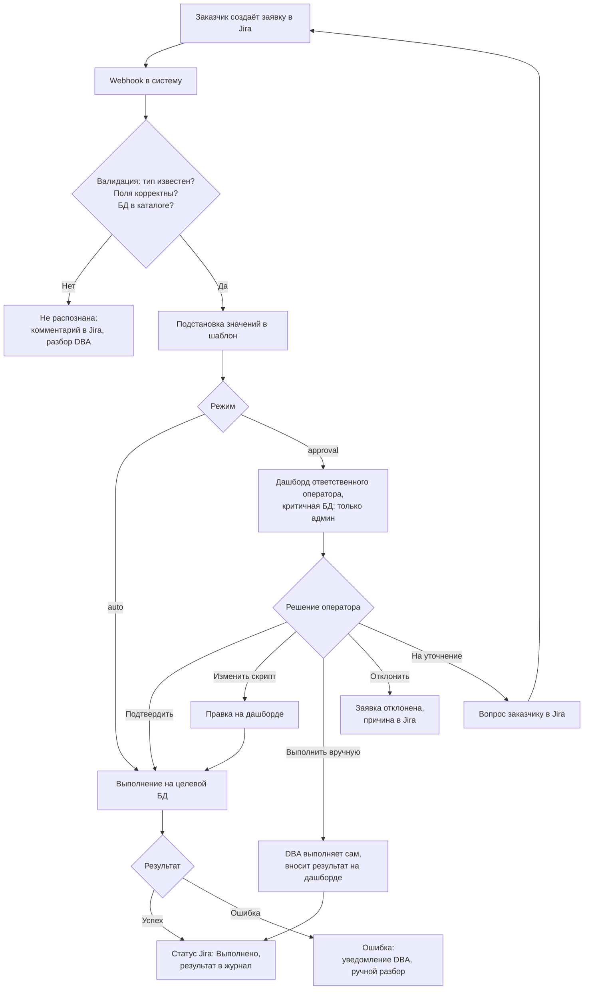
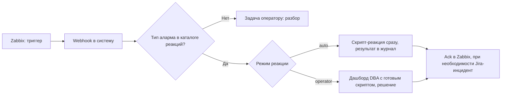

# Система автоматизации работы DBA

#### Версия: 1.0

## 1. Цель и контекст

Как сейчас. В управлении DBA больше 100 баз (Oracle, PostgreSQL, MySQL) нескольких компаний группы. Заявки приходят через портал Jira («Центр поддержки»), типы заявок для DBA уже заведены: восстановление данных, создание объекта БД, открытие/изменение доступа, согласование скрипта, манипуляция данными, репликация, постановка на обслуживание, «прочее». Но ключевые поля (БД, схема, объект, учётка) заполняются свободным текстом, а суть часто лежит в «Описании». Автоматически такую заявку не обработать: DBA разбирает каждую руками — уточняет, подбирает скрипт, выполняет, отписывается. Медленно, качество зависит от исполнителя, история размазана по тикетам.

Что хотим — систему, которая:

- принимает заявки из Jira в типизированном виде (тип операции плюс структурированные поля);
- подставляет значения в согласованные заранее скрипты;
- выполняет их сама (для безопасных операций) или после апрува DBA на дашборде;
- ведёт журнал: кто запросил, что и где выполнено, каким скриптом, с каким результатом;
- обновляет статус заявки в Jira;
- реагирует на алармы Zabbix.

Что это даёт: рутина уходит с DBA, заказчик видит статус без переписки, все изменения на БД идут через один журналируемый канал.

## 2. Роли

| Роль              | Кто это                                                       | Что делает                                                                                                              |
| ----------------- | ------------------------------------------------------------- | ----------------------------------------------------------------------------------------------------------------------- |
| Заказчик          | Любой сотрудник (разработчик, QA, аналитик), не эксперт по БД | Создаёт заявку в Jira: выбирает тип операции и БД из справочников, заполняет поля, отвечает на уточнения                |
| DBA-оператор      | Дежурный DBA, отвечает за закреплённый за ним набор БД        | Работает с дашбордом по задачам своих БД: подтверждает, правит, отклоняет или возвращает на уточнение, разбирает ошибки |
| DBA-администратор | Старший DBA, владелец процесса                                | Ведёт каталог типов заявок и шаблонов; назначает операторам их набор БД; обслуживает критичные инстансы                 |
| Система           | Оркестратор                                                   | Принимает вебхуки Jira и Zabbix, валидирует заявки, готовит и выполняет скрипты, пишет журнал, обновляет Jira           |

Заказчик не DBA, поэтому форма должна быть простой: справочники вместо свободного текста, понятные названия полей, подсказки. Корректность проверяют система и DBA, а не заказчик.

## 3. Ключевые сущности

| Сущность | Что содержит | Зачем |
|---|---|---|
| Каталог БД | Имя, компания, тип СУБД, окружение (test/stage/prod), владелец, ответственный оператор (или группа), класс критичности (обычная / только админы); для Oracle — default tablespace для новых учёток | Заказчик выбирает БД из списка по компании; система знает, куда подключаться, насколько критична среда и кому направить задачу |
| Учётка DBA-инженера | Оператор или админ; при заведении получает список закреплённых БД (у админа — доступ и к критичным) | Определяет, чьи задачи попадают на дашборд; критичные инстансы видят только админы |
| Тип заявки | Операция, набор полей, ссылка на шаблон скрипта, режим `auto` или `approval` | Делает заявку машиночитаемой |
| Шаблон скрипта | Параметризованный SQL, версия, метаданные: СУБД, уровень риска, режим | Единый согласованный способ выполнить операцию |
| Задача | Из Jira-заявки или аларма Zabbix: источник, тип, подставленные значения, итоговый скрипт, статус, решения DBA | Единица работы внутри системы |
| Журнал | Кто запросил и одобрил, что и где выполнено, каким скриптом (с правками), когда, результат | Аудит и разбор инцидентов |

## 4. Основной флоу



1. Заявка. Заказчик выбирает тип операции и БД из справочников, заполняет обязательные поля.
2. Вебхук. Jira шлёт событие, система создаёт задачу и привязывает к тикету.
3. Валидация. Тип есть в каталоге, обязательные поля корректны, БД в реестре, а введённые текстом значения (схема, объект, учётка) есть в целевой БД. Ошибка формата или каталога — «Не распознана», разбор DBA; несуществующее значение — комментарий заказчику и «На уточнении».
4. Подготовка скрипта. Система подставляет значения в шаблон типа заявки и сохраняет готовый скрипт в задаче.
5. Режим. `auto` — операция заранее признана безопасной, выполняется сразу; `approval` — уходит на дашборд. Критичные инстансы всегда `approval` и только у админов, `auto` для них отключён.
6. Дашборд. Задача попадает оператору, ответственному за эту БД (критичные — админам). Оператор видит заявку, целевую БД с окружением и итоговый скрипт. Действия:
   - Подтвердить — выполнить как есть.
   - Изменить и выполнить — правка скрипта для этой задачи, шаблон не меняется, правка в журнале.
   - Выполнить вручную — автовыполнение отключается, DBA делает сам и вносит результат на дашборде; журнал и статус Jira система пишет сама с пометкой «вручную».
   - Отклонить — заявка закрывается с причиной.
   - На уточнение — вопрос заказчику, задача ждёт ответа.
7. Выполнение. Система подключается к БД, выполняет скрипт, сохраняет результат в журнал.
8. Завершение. Успех — статус Jira «Выполнено» и комментарий. Ошибка — задача «Ошибка», уведомление DBA, ручной разбор.

## 5. Статусная модель задачи

| Статус задачи | Что значит | Статус в Jira |
|---|---|---|
| Новая | Получена, ещё не проверена | Open |
| Не распознана | Не прошла валидацию | Canceled |
| Ожидает апрува | Скрипт готов, ждёт решения DBA | In Progress |
| На уточнении | Возвращена заказчику | На уточнении |
| Отклонена | DBA отказал | Canceled |
| Выполняется | Скрипт запущен | In Progress |
| Выполнена | Успех (скриптом или вручную) | Done |
| Ошибка | Выполнение упало | In Progress |

Названия статусов Jira подгоняются под существующий workflow.

## 6. Типизация заявок

Заявка = тип операции плюс структурированные поля, а не свободный текст.

Существующие формы «Центра поддержки» — готовый каркас, но их надо доработать: БД, схему, объект и учётку сейчас вводят свободным текстом (нужны справочники и валидация); составное поле «Сотруднику / Учётной записи / Роли» надо разбить на «тип получателя» плюс значение; параметры из «Описания» вынести в отдельные поля. «Прочее» остаётся для нестандартных случаев и всегда идёт в ручной разбор.

### Формы разделены по СУБД

Формы Oracle и PostgreSQL — разные: набор операций отличается (`CREATE DATABASE` есть только в PostgreSQL; в Oracle пользователь и есть схема). Заказчик выбирает СУБД явно, «универсальную» форму не делаем.

Компания и БД — два поля: сначала компания, затем список БД по ней, отфильтрованный по СУБД.

### Каталог заявок

| Операция | PostgreSQL | Oracle |
|---|---|---|
| Создание учётной записи | PG-1 | ORA-1 |
| Выдача прав существующей учётке | PG-2 | ORA-2 |
| Отзыв роли | PG-3 | — |

Создание учётки и выдача прав — разные операции: учётку заводят один раз, права выдают и меняют потом, для уже существующей учётки. Их можно совместить: в PG-1/ORA-1 есть флажок «Выдать права сразу», который подключает тот же блок полей выдачи прав.

Права выдаём на конкретную схему (реже — на отдельные объекты), а не на всю БД. Доступ ко всей базе — отдельный выбор и всегда через апрув.

### Что проверяет Jira, а что система

Jira в момент заполнения никуда не ходит, поэтому на её стороне только статичные проверки: обязательность полей, формат по маске, фиксированные выпадающие списки (тип доступа, пресет прав) и каскад «компания, затем БД» из заранее выгруженного каталога. Существует ли роль, схема или свободно ли имя учётки — Jira не знает.

Живые проверки делает система после вебхука, обращаясь к словарю целевой БД: существование и занятость учётки, роли, схемы и объекта; соответствие привилегий типу объекта; окружение (prod и критичные — принудительный `approval`). Это требует read-доступа к словарю; где его нет, проверка сводится к формату и ручному разбору. Поэтому поля вроде «роль» или «учётка» в формах — текст: Jira их не подскажет, существование проверит система.

### PG-1. Создание учётной записи PostgreSQL

Заводит логин. Права — сразу по флажку или потом заявкой PG-2.

| Поле | Тип в Jira | Пример |
|---|---|---|
| Компания | переключатель | НУР Телеком |
| БД | select из каталога по компании, только PostgreSQL | `credit-prod` |
| Имя учётной записи | текст, маска: латиница, цифры, `_` | `external_prod` |
| Выдать права сразу | флажок, по умолчанию выкл | вкл |
| Блок выдачи прав | при флажке — поля как в PG-2 | — |
| Описание | текст | интеграция с внешним сервисом |

```sql
CREATE USER external_prod WITH LOGIN PASSWORD '<сгенерирован>' VALID UNTIL '<+3 дня>';
```

### PG-2. Выдача прав существующей учётке PostgreSQL

| Поле | Тип в Jira | Пример |
|---|---|---|
| Компания / БД | переключатель / select, только PostgreSQL | `credit-prod` |
| Учётная запись | текст, проверит система | `external_prod` |
| Область | select: схема / собственная схема (владелец) / существующая роль | схема |
| Схема | текст, для «схема» и «собственная схема» | `billing` |
| Объём | select: все объекты / конкретные объекты, для «схема» | все объекты |
| Объекты | текст, список, при «конкретные объекты» | `invoices, payments` |
| Привилегии | по типу объекта: таблицы и представления — SELECT/INSERT/UPDATE/DELETE; функции — EXECUTE; последовательности — USAGE/SELECT | SELECT |
| Роль | текст, для «существующая роль» | `credit_prod_role` |
| Права на будущие объекты | флажок, для «собственная схема» | вкл |
| Описание | текст | доступ на чтение витрины |

Область «схема», все объекты (для конкретных — вместо `ALL TABLES` перечисляются объекты):

```sql
GRANT USAGE ON SCHEMA billing TO external_prod;
GRANT SELECT ON ALL TABLES IN SCHEMA billing TO external_prod;
```

Область «собственная схема» (владелец):

```sql
CREATE SCHEMA AUTHORIZATION external_prod;
GRANT USAGE, CREATE ON SCHEMA external_prod TO external_prod;
GRANT ALL PRIVILEGES ON ALL TABLES    IN SCHEMA external_prod TO external_prod;
GRANT ALL PRIVILEGES ON ALL SEQUENCES IN SCHEMA external_prod TO external_prod;
ALTER DEFAULT PRIVILEGES IN SCHEMA external_prod GRANT ALL PRIVILEGES ON TABLES    TO external_prod;
ALTER DEFAULT PRIVILEGES IN SCHEMA external_prod GRANT ALL PRIVILEGES ON SEQUENCES TO external_prod;
```

Область «существующая роль»:

```sql
GRANT "credit_prod_role" TO "external_prod";
```

### PG-3. Отзыв роли у учётной записи PostgreSQL

| Поле | Тип в Jira | Пример |
|---|---|---|
| Компания / БД | переключатель / select, только PostgreSQL | `credit-prod` |
| Учётная запись | текст, проверит система | `external_prod` |
| Роль | текст, наличие у учётки проверит система | `credit_prod_role` |
| Описание | текст | доступ больше не нужен |

```sql
REVOKE "credit_prod_role" FROM "external_prod";
```

### ORA-1. Создание учётной записи Oracle

Заводит пользователя (в Oracle пользователь = схема) и право на подключение. Права — сразу по флажку или потом заявкой ORA-2. Выделенный tablespace не создаём, но default tablespace задаём из каталога (не `SYSTEM`).

| Поле | Тип в Jira | Пример |
|---|---|---|
| Компания / БД | переключатель / select, только Oracle | `techdwh` |
| Имя учётной записи / схемы | текст, маска, верхний регистр | `IENERGY` |
| Выдать права сразу | флажок, по умолчанию выкл | вкл |
| Блок выдачи прав | при флажке — поля как в ORA-2 | — |
| Описание | текст | загрузчик данных DWH |

```sql
CREATE USER IENERGY IDENTIFIED BY "<сгенерирован>"
  DEFAULT TABLESPACE APP_DATA TEMPORARY TABLESPACE TEMP PASSWORD EXPIRE;
GRANT CREATE SESSION TO IENERGY;
```

### ORA-2. Выдача прав существующей учётке Oracle

| Поле | Тип в Jira | Пример |
|---|---|---|
| Компания / БД | переключатель / select, только Oracle | `techdwh` |
| Учётная запись | текст, проверит система | `IENERGY` |
| Область | select: схема / владелец своей схемы / вся БД (ANY) | схема |
| Схема | текст, для «схема» | `billing` |
| Объём | select: все объекты / конкретные объекты, для «схема» | все объекты |
| Объекты | текст, список, при «конкретные объекты» | `invoices, payments` |
| Привилегии | по типу: таблицы и представления — SELECT/INSERT/UPDATE/DELETE; процедуры, функции, пакеты — EXECUTE; последовательности — SELECT | SELECT |
| Публичные синонимы | флажок, для «владелец своей схемы» | выкл |
| Database links | флажок, для «владелец своей схемы» | выкл |
| Описание | текст | доступ на чтение схемы billing |

Область «схема» разворачивается в гранты по объектам (на Oracle 23ai — одной командой `GRANT SELECT ANY TABLE ON SCHEMA billing`):

```sql
GRANT SELECT ON billing.invoices TO IENERGY;
GRANT SELECT ON billing.payments  TO IENERGY;
```

Область «владелец своей схемы». Владельцу нужна квота на его default tablespace, иначе `CREATE TABLE` не сработает:

```sql
ALTER USER IENERGY QUOTA UNLIMITED ON APP_DATA;
GRANT CREATE TABLE, CREATE VIEW, CREATE SEQUENCE,
      CREATE PROCEDURE, CREATE TRIGGER, CREATE SYNONYM,
      CREATE MATERIALIZED VIEW, CREATE JOB TO IENERGY;
```

Флажки: публичные синонимы — `GRANT CREATE PUBLIC SYNONYM` (общие на всю БД, редко, через апрув; приватные синонимы даёт `CREATE SYNONYM` из пресета владельца); database links — `GRANT CREATE DATABASE LINK`.

Область «вся БД (ANY)» — по умолчанию не выбрана, всегда через апрув:

```sql
GRANT SELECT ANY TABLE, INSERT ANY TABLE, UPDATE ANY TABLE, DELETE ANY TABLE TO IENERGY;
```

### Пароль новых учёток

Пароль создают только PG-1 и ORA-1. Система генерирует его сама, отправляет автору защищённым каналом (сейчас корпоративная почта), в Jira и журнал не пишет. Пароль временный: Oracle — `PASSWORD EXPIRE` (смена при первом входе); PostgreSQL штатной смены при входе не имеет, поэтому короткий `VALID UNTIL` плюс регламент.

## 7. Каталог скриптов

- Шаблоны версионируются в git: видно, кто и когда менял и почему.
- Метаданные шаблона: СУБД, тип заявки, параметры, режим `auto`/`approval`, уровень риска.
- Изменение шаблона идёт через DBA-администратора с ревью.
- Правка оператором на дашборде действует только на конкретную задачу и пишется в журнал.
- Набор шаблонов пока небольшой и фиксированный, новый тип операции добавляет разработка.

## 8. Реакция на алармы Zabbix



- Для известных алармов в каталоге описана реакция: скрипт плюс режим (`auto` — например, расширить tablespace при пороге; `operator` — решает человек).
- Неизвестные алармы уходят оператору как есть.
- Обратная связь: запись в журнал, при необходимости Jira-инцидент или отчёт в канал.

## 9. Принципы контроля и безопасности

1. Полный аудит. Каждое выполнение: кто запросил и одобрил, какой скрипт (с правками), на какой БД, когда, результат. Журнал не редактируется.
2. `auto` — только для низкорисковых операций, это свойство типа заявки. Остальное — апрув.
3. Предпросмотр всегда: DBA видит финальный скрипт с подставленными значениями до выполнения.
4. Ограниченные права системы на целевых БД. Вариант — выдавать разовые креды на операцию через vault (обсуждаемо).
5. Разделение окружений: prod и критичные инстансы помечены в каталоге, для них режим строже (например, только `approval`).
6. Упавший скрипт не перезапускается автоматически — только решением DBA после разбора.
7. Пароль новой учётки не попадает в Jira, журнал и логи, отправляется автору защищённым каналом, всегда временный.

## 10. Открытые вопросы к DBA

1. Операции. Опишите операции, которые хотим автоматизировать: что за операция, для чего нужна, кому обычно она нужна и как часто, на каких СУБД. По каждой — типовой скрипт или пример и какие значения в нём подставляются. Это вход для набора типов заявок и шаблонов.
2. Режимы: какие операции допустимы в `auto` и на каких окружениях.
3. Апрув: кто подтверждает, нужен ли двойной апрув (сначала старший или админ, потом оператор) и на какие БД (prod, критичные).
4. Zabbix, алармы: какие алармы приходят сегодня, где реакция типовая (кандидаты в `auto`), где нужен человек.
5. Zabbix, реакция по шагам: опишите реакцию на аларм не одним скриптом, а последовательностью — что проверить (реально ли сработало и почему), что выполнить, как убедиться, что делать, если не сработал скрипт или какое-то действие. Дайте пример на конкретном аларме, например заполнение tablespace: скрипты, при которых допустим `auto`, а при которых только оператор.
6. Ошибки: какие ошибки бывают при выполнении (нет доступа или квоты, объект уже существует, блокировка, таймаут, синтаксис после ручной правки, частичное выполнение), где нужен rollback-скрипт, где только ручной разбор и кто его делает.
7. Уведомления: о каких событиях уведомлять (задача ждёт апрува, задача выполнена или упала, аларм требует оператора, заявка долго висит на уточнении), кому (дежурный по этой БД, вся группа), каким каналом (почта, мессенджер, дашборд) и с какой срочностью.
