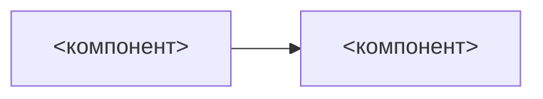

# Design: {{PROJECT}}

Статус: черновик | ревью | approved | as-built; Ревьюеры: <кто>; Brief: `00-brief.md`; Дата: {{DATE}}

## Контекст
2-3 абзаца: что есть сейчас, почему текущее не работает. Ссылки на системы и код.

## Цели / не цели
Цели - измеримые цели дизайна (бизнес-цели остаются в brief). Не цели - что осознанно не решаем
в этой версии.

## Обзор
Одна схема уровня C4 Container: сервисы и компоненты, что между ними ходит. Не больше семи блоков.
Абзац: как основной сценарий проходит через компоненты.

## Детальный дизайн

### Модель данных
Для каждой сущности: бизнес-смысл, сервис-владелец, объёмы и прирост, поля по назначению
с обязательностью и размерностью, связи и их тип, уникальность, основные выборки и индексы,
utf8-поля, значения boolean по умолчанию, начальное заполнение. Только то, что влияет на решения.

### API и контракты
Для каждого роута: контекст вызова, метод и URI, параметры с обязательностью, аутентификация,
роли и скоупы, тело запроса и ответа по назначению полей, валидация, идемпотентность, формат
ошибок с кодами, ожидаемая нагрузка. Внешние контракты - OpenAPI/AsyncAPI рядом в `assets/`.

### Ключевые сценарии
Sequence-диаграммы для 1-3 неочевидных сценариев. Обязательно сценарии отказа: упала БД,
не пришёл ответ, дубль сообщения, таймаут. Точки невозврата.

### Джобы
Для каждого: назначение, критерии отбора записей, расписание, объём за запуск, параллельность
и партиционирование, батч, повторная обработка, единственный экземпляр или несколько,
поведение при ошибке, метрики.

### Хранение и инфраструктура
Где живёт, как деплоится, конфигурация, секреты (Vault, не в коде).

## NFR
Нагрузка, задержки, retention, доступность - числами.

## Рассмотренные альтернативы
2-3 отвергнутых варианта, по абзацу: что и почему нет. При соревновании вариантов - из
`options/verdict.md`.

## Риски и открытые вопросы
- <риск> -> <как страхуемся>
- <открытый вопрос> - <владелец>, <срок>

## Тестирование и выкатка
Уровни тестов и что проверяем руками. Выкатка: feature flag, параллельный запуск, миграции данных.
Откат. Мониторинг и алерты.

## Чек-лист перед approved
- [ ] схема Container-уровня, блоков <= 7
- [ ] сценарии отказа описаны
- [ ] контракты зафиксированы до кода
- [ ] по каждой сущности: объёмы, владелец, основные выборки
- [ ] альтернатив >= 2
- [ ] NFR числами
- [ ] тестирование, выкатка, откат, мониторинг заполнены
- [ ] ревьюер прочитал или прошли сутки
- [ ] не длиннее 400 строк
